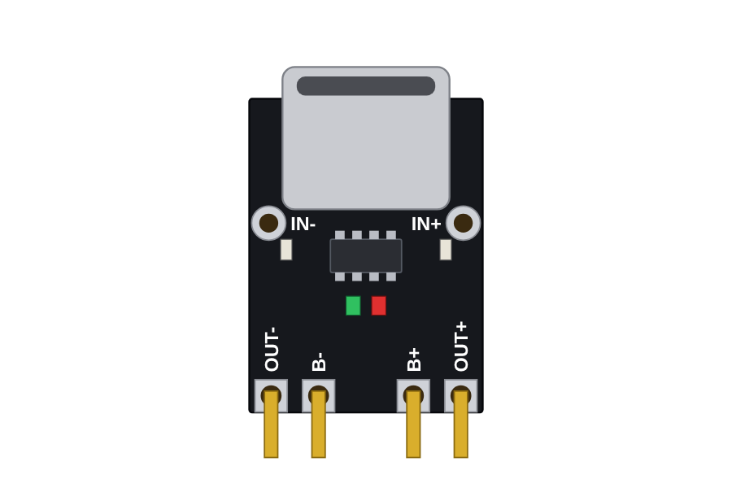
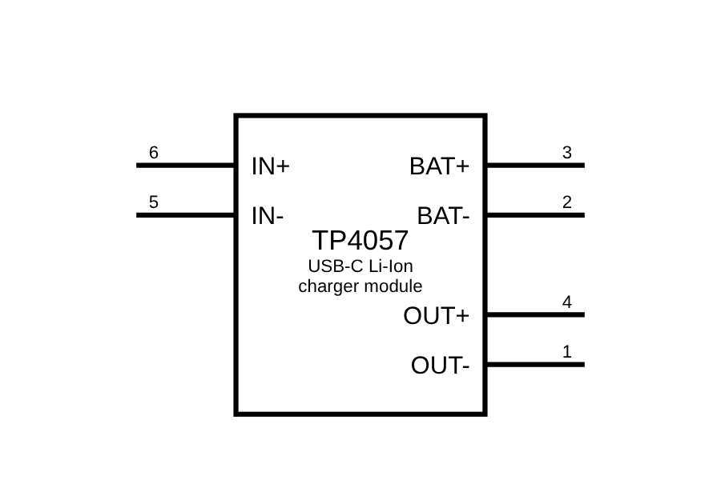
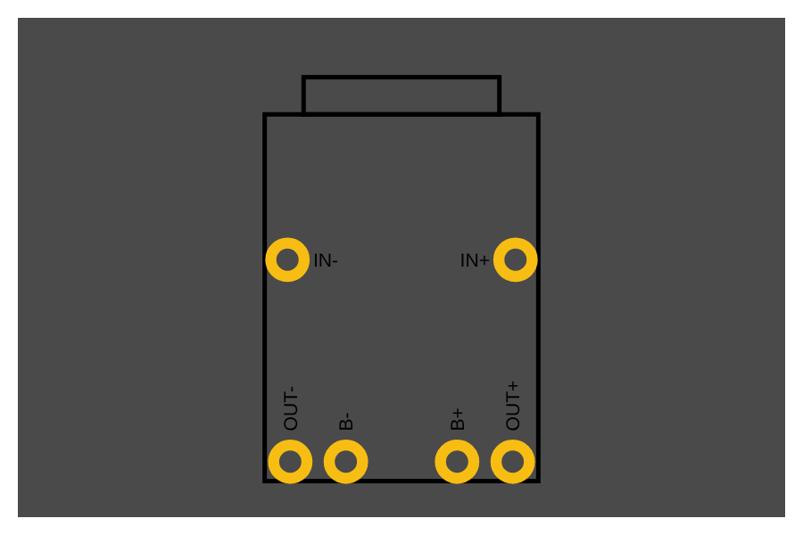

# TP4057 USB-C Li-Ion charger module: Fritzing part

A custom [Fritzing](https://fritzing.org) part for the small TP4057 USB-C single-cell Li-Ion/LiPo charger module (board marking LX-LBES, 5 V input, 1 A charge current, B+/B- battery pads and OUT+/OUT- load pads).

| Breadboard | Schematic | PCB |
|---|---|---|
|  |  |  |

## Install

1. Download [`tp4057_usbc_charger.fzpz`](tp4057_usbc_charger.fzpz).
2. In Fritzing: **File -> Import...** and select the file.
3. The part appears in the **My Parts** bin (search "TP4057").

## Pins (6 connectors)

| Pin | Name | Description |
|---|---|---|
| 1 | OUT- | Load output, negative |
| 2 | BAT- | Battery negative (B-) |
| 3 | BAT+ | Battery positive (B+) |
| 4 | OUT+ | Load output, positive |
| 5 | IN- | Power input negative, solder pad next to the USB-C port |
| 6 | IN+ | Power input 5 V, solder pad next to the USB-C port |

Numbers are connector index + 1. The four bottom pads sit on the 0.1 in grid (0.1 / 0.2 / 0.1 in spacing), so the module fits a female header or perfboard. The module's OUT pins follow the battery voltage, not a regulated 5 V.

## Known limitations

- **Estimated geometry:** the outline and pad positions were taken from product photos, not a drawing. The board is drawn 12.5 x 16.8 mm plus a 1.7 mm USB-C overhang. One real module measured about 14 mm wide and 17.75 mm long, so check yours with calipers and adjust the constants at the top of `tools/gen_part.py` before using the footprint for a manufactured board.
- The PCB view has copper pads on both copper layers (through-hole style) and only a silkscreen outline for the body.
- Labels in the SVGs use live text (Droid Sans) rather than outlines.

## Repository layout

```
tp4057_usbc_charger.fzpz   importable part
src/                       .fzp and SVGs (breadboard, schematic, pcb, icon)
images/                    previews
tools/gen_part.py          generator: rebuilds src/ and the .fzpz
```

Rebuild with `python3 tools/gen_part.py <output-dir>`.

## License

[CC BY-SA 4.0](https://creativecommons.org/licenses/by-sa/4.0/), the same license as the Fritzing core parts. See `LICENSE`.
